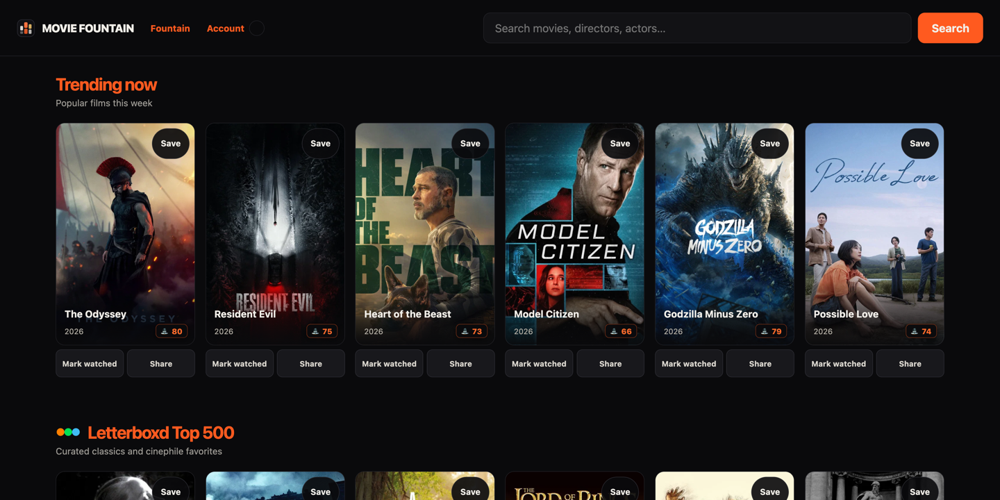
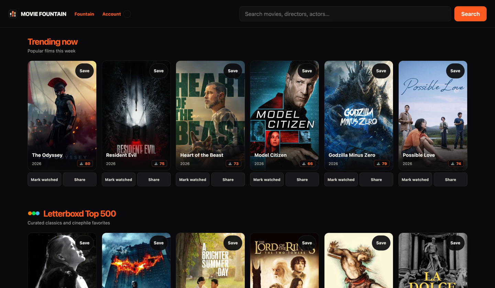
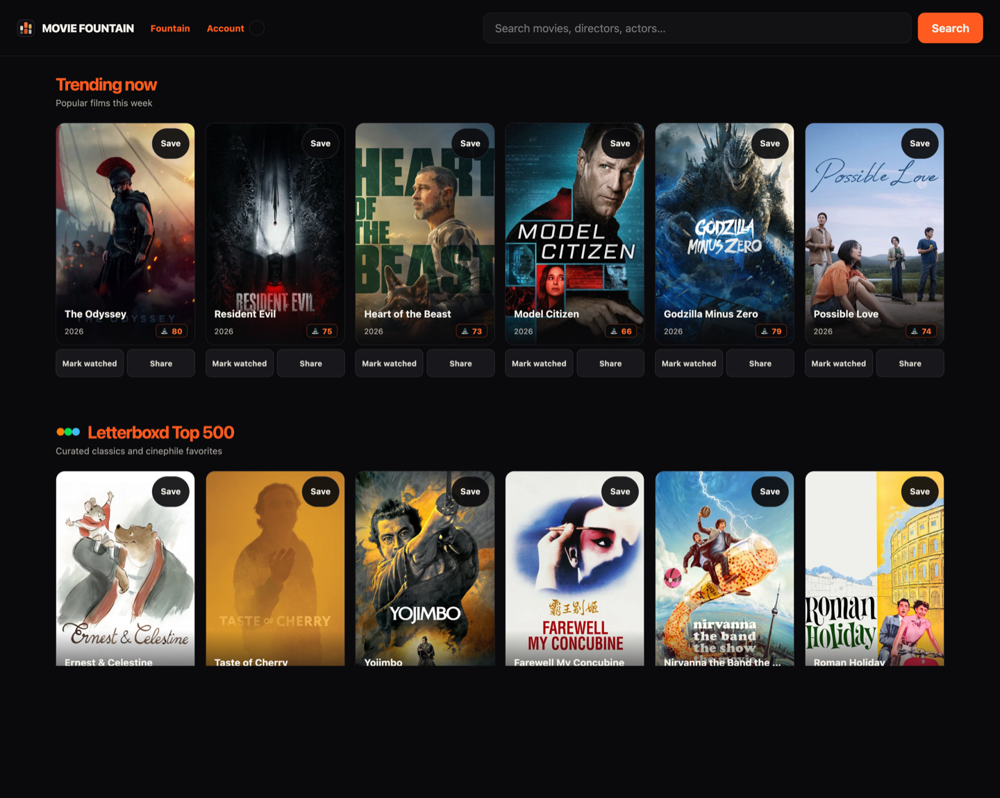
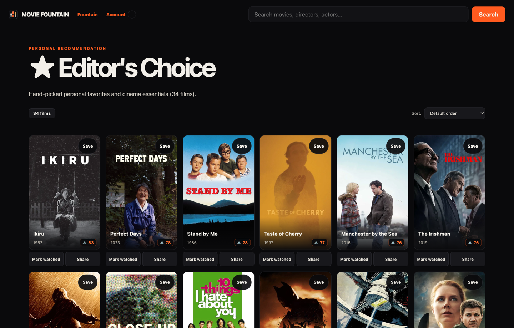
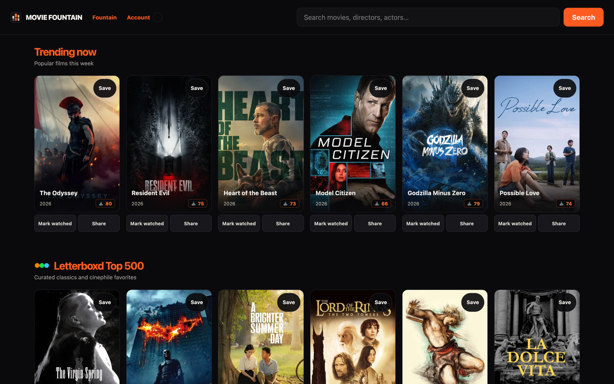
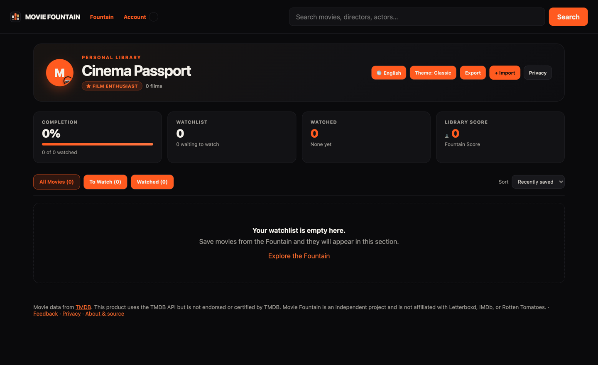
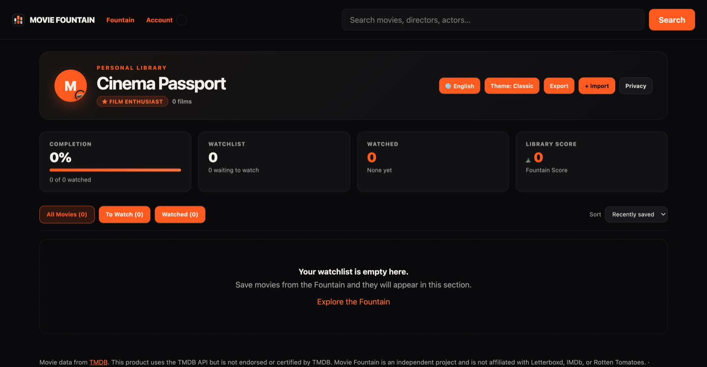
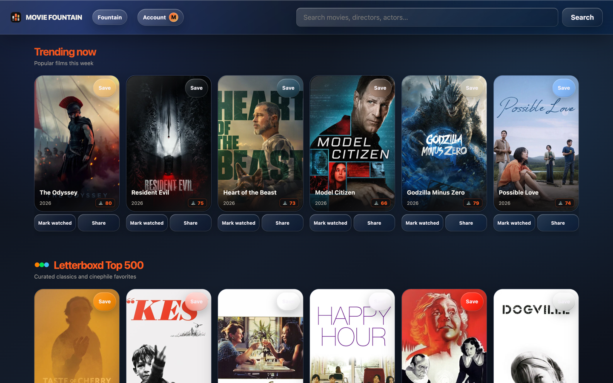
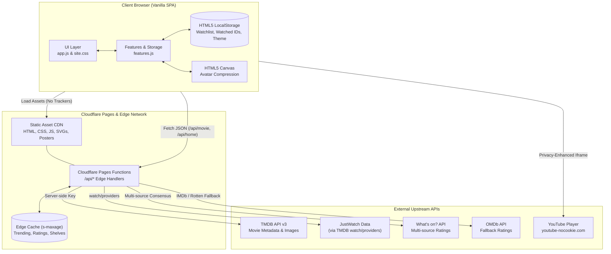

<p align="center">
  
</p>

# 🍿 Movie Fountain

<p align="center">
  <strong>An expressive, privacy-first film discovery engine and cinephile companion powered by Cloudflare Pages & edge functions.</strong>
</p>

<p align="center">
  <a href="https://movie-fountain.pages.dev/"></a>
  <a href="https://github.com/Snowstormme/movie-fountain"></a>
</p>

<p align="center">
  
  
  
  
  
  
</p>

---

## 📑 Table of Contents

- [The Mission: A Movie Night Without Endless Scrolling](#-the-mission-a-movie-night-without-endless-scrolling)
- [✨ Key Visual Showcase & Features](#-key-visual-showcase--features)
  - [1. Continuous Fountain Discovery Stream](#1-continuous-fountain-discovery-stream)
  - [2. Where to Watch (Streaming Providers Hub)](#2-where-to-watch-streaming-providers-hub)
  - [3. Editorial Canon & Curated Charts](#3-editorial-canon--curated-charts)
  - [4. Multi-Source Ratings & Masterpiece Verdict](#4-multi-source-ratings--masterpiece-verdict)
  - [5. Cinephile Passport & Custom Avatars](#5-cinephile-passport--custom-avatars)
  - [6. Dual Aesthetic Design System](#6-dual-aesthetic-design-system)
- [🏗️ System Architecture & Data Flow](#️-system-architecture--data-flow)
- [💻 Technology Stack](#-technology-stack)
- [📁 Repository Structure](#-repository-structure)
- [⚡ Getting Started & Local Development](#-getting-started--local-development)
  - [Prerequisites](#prerequisites)
  - [Running Unit Tests](#running-unit-tests)
  - [Local Edge Server (Wrangler)](#local-edge-server-wrangler)
  - [Environment Configuration](#environment-configuration)
- [🛡️ Security, Privacy & Third-Party Data](#️-security-privacy--third-party-data)
- [📄 License & Contributing](#-license--contributing)

---

## 🎯 The Mission: A Movie Night Without Endless Scrolling

Movie night shouldn't begin with twenty minutes of decision paralysis, clicking through dense grids and stale algorithmic suggestions.

**Movie Fountain** reimagines movie discovery as a fluid, animated stream:
- **Watch posters gently flow across your screen** at your preferred cadence.
- **Filter intuitively on the fly** by mood, genre, release era (from classic Hollywood to 2020s), and runtime cap.
- **Instantly see where to stream or rent** across international platforms (Netflix, Apple TV, Amazon Prime, Okko, Kinopoisk, Ivi, Pluto TV) with country flag switchers.
- **Consult a synthesized multi-source consensus** (IMDb, Letterboxd, Rotten Tomatoes Critics & Audience, and TMDB) topped by an exclusive golden **Masterpiece** verdict.
- **Track your journey** with a local **Cinephile Passport**, custom avatars, and offline-first watchlist management.

All with **zero accounts, zero ads, zero trackers, and zero telemetry**.

---

## ✨ Key Visual Showcase & Features

### 1. Continuous Fountain Discovery Stream

The core experience of Movie Fountain is an uninterrupted, horizontally moving stream of curated cinematic posters.

<p align="center">
  
</p>

- **Dynamic Speed Controls**: Toggle smoothly between **Slow** (50 px/s), **Normal** (100 px/s), and **Fast** (150 px/s) using CSS and JavaScript `playbackRate` synchronization.
- **Instant Play/Pause & Keyboard Accessibility**: Spacebar or screen tap halts the flow immediately so you can inspect movie details, watch trailers, or save to your watchlist.
- **Multi-Dimensional Refinements**:
  - **Mood & Genre**: Filter by Drama, Sci-Fi, Thriller, Comedy, Animation, Noir, and more.
  - **Release Era**: Pinpoint films by specific decades (70s, 80s, 90s, 2000s, 2010s, 2020s).
  - **Runtime Ceiling**: Filter out long movies when you only have 90 or 120 minutes.
  - **Hide Watched**: Exclude films already logged in your Cinephile Passport.

---

### 2. Where to Watch (Streaming Providers Hub)

Never wonder where a film is available. Integrated directly with **JustWatch** via TMDB's streaming endpoints, every film detail page reveals real-time regional streaming availability.

<p align="center">
  
</p>

- **Tiered Categories**: Clear separation between **Stream** (subscription-based like Netflix, Apple TV+, Amazon Prime), **Free** (ad-supported platforms like Pluto TV), and **Rent / Buy** (Apple Store, Google Play, Amazon Video).
- **Official Brand Logos**: High-fidelity 32×32 vector and raster badges with crisp hover states and accessible tooltips.
- **Interactive Regional Switcher**: Rapidly switch between major regions (`🇷🇺 RU`, `🇺🇸 US`, `🇬🇧 GB`, `🇩🇪 DE`, `🇫🇷 FR`, `🇨🇦 CA`) with automatic timezone and language detection.
- **Direct JustWatch Deep Link**: One-click jump to full pricing breakdown, 4K HDR badges, and provider details.

---

### 3. Editorial Canon & Curated Charts

Beyond algorithmic discovery, Movie Fountain includes curated, offline-ready cinematic canons and edge-cached charts.

<p align="center">
  
</p>

<p align="center">
  
</p>

- **Editor's Choice (34 Masterpieces)**: A hand-curated catalog featuring cinema milestones spanning world cinema (*The Godfather*, *2001: A Space Odyssey*, *Close-Up*, *Taste of Cherry*, *The Green Mile*, *GoodFellas*, *The Shawshank Redemption*, *Arrival*, *Blade Runner 2049*, *Oppenheimer*, *Interstellar*, *Papillon*).
- **IMDb Top 250 & Letterboxd Top 500**: Complete, authentic datasets available both as dedicated charts and as filtered Fountain streams.
- **Trending & Upcoming Charts**: 100 trending global titles and 60 most-anticipated releases refreshed regularly at the Cloudflare edge.
- **Real-Time In-List Sorting**: Sort any chart instantly by **Rating** (highest / lowest), **Release Date** (newest / oldest), or **Title** (A–Z / Z–A).

---

### 4. Multi-Source Ratings & Masterpiece Verdict

Movie Fountain ends the bias of single-platform ratings by calculating an aggregated multi-source consensus.

| Rating Authority | Metric | Visual Treatment |
| :--- | :--- | :--- |
| **IMDb** | Weighted Mean (1–10) | Official Gold Vector Badge (`#f5c518`) |
| **Letterboxd** | Community Rating (1–5) | Official Iconic 3-Circle Logomark (`#00e054`) |
| **Rotten Tomatoes** | Critics Tomatometer & Audience Popcorn (0–100%) | Certified Tomato / Popcorn Badges |
| **TMDB** | Global User Score (0–100%) | TMDB Cyan Rating Meter |
| **Fountain Consensus** | Universal Aggregate Score (0–100) | Prominent Header Badge & Qualitative Tag |

- **Golden Masterpiece Verdict**: For films achieving a consensus score of **90 or above**, Movie Fountain displays an exclusive, shimmering golden **Masterpiece** badge.
- **Non-Blocking Asynchronous Edge Fetching**: Core movie metadata and backdrop artwork render in sub-100ms, while external ratings load asynchronously in the background and cache at the edge for 1 hour (`Cache-Control: public, max-age=3600, s-maxage=3600`).

---

### 5. Cinephile Passport & Custom Avatars

Your movie habits, watched diary, and watchlist live in your browser's private storage—no sign-up, no email, no cloud tracking.

<p align="center">
  
  
</p>

- **Dynamic Cinephile Ranks**: Progress automatically as you log films:
  - *Casual Viewer* ➔ *Movie Buff* ➔ *Cinephile* ➔ *Film Scholar* ➔ *Auteur in the Making* ➔ *Film Historian*.
- **Completion Metrics**: Track your saved watchlist count, watched percentage, and quick action filters (`All`, `To Watch`, `Watched`).
- **Local Avatar Studio**: Choose from classic cinema character presets or upload any personal photo. Custom photos are automatically resized and compressed client-side to a 200×200 JPEG via HTML5 Canvas—nothing is ever transmitted to a server.
- **Data Sovereignty**: Export your entire diary and watchlist as clean JSON anytime, or merge-import previous backups across devices without data loss.

---

### 6. Dual Aesthetic Design System

Movie Fountain features two complete visual design systems crafted with modern CSS variables, backdrop blurs, and responsive typography:

<p align="center">
  
</p>

1. **Classic Flame Cinema**:
   - Deep Jet Black (`#0a0a0c`) foundation with warm Soft White (`#f2efe9`) typography and Flame Orange (`#ff5a1f`) kinetic accents.
2. **Liquid Glass (Midnight Sapphire)**:
   - Deep cobalt midnight abyss (`#0b0f18`), frosted glass cards (`backdrop-filter: blur(16px)`), cyan/ice-sapphire active button glows (`#38bdf8`), and electric neon highlights.
- **Zero Theme Flash**: The site uses static `data-theme="current"` to apply the user's stored aesthetic before first paint, preventing white flashes on dark screens.

---

## 🏗️ System Architecture & Data Flow

Movie Fountain follows a lean, serverless Jamstack pattern designed for maximum uptime, high security, and minimal operating costs.



### Architectural Principles

1. **Zero Client-Side Credentials**:
   - API tokens (`TMDB_API_KEY`, `OMDB_API_KEY`) reside exclusively in encrypted Cloudflare Pages environment variables. The client never touches an API key.
2. **Defensive Content Security Policy (CSP)**:
   - Configured in [`_headers`](file:///Users/me/.gemini/antigravity/scratch/movie-fountain/_headers) with `default-src 'self'`, `frame-src https://www.youtube-nocookie.com`, and `object-src 'none'`.
3. **Resilient Ratings Fallback Pipeline**:
   - If What's on? API is rate-limited or unavailable, the system automatically falls back to curated snapshots in [`ratings_snapshot.js`](file:///Users/me/.gemini/antigravity/scratch/movie-fountain/functions/_lib/ratings_snapshot.js) and optional OMDb lookups without interrupting UI rendering.
4. **Strict Sanitization & XSS Prevention**:
   - URL hashes and query parameters are parsed through strict numeric matchers (`safeNumericId`), and all template strings pass through HTML entity escaping (`esc()`). Verified clean with **0 alerts** on GitHub CodeQL.

---

## 💻 Technology Stack

| Layer | Technologies | Purpose |
| :--- | :--- | :--- |
| **Frontend Runtime** | Vanilla JavaScript (ES2022+), HTML5, Canvas | Ultra-fast SPA with zero bloated runtime frameworks |
| **Styling & Design** | CSS3 Custom Properties, Flexbox, Grid, Backdrop Filters | Dual themes (Classic & Liquid Glass), responsive across mobile/desktop |
| **Edge Hosting** | Cloudflare Pages & Pages Functions | Worldwide sub-50ms latency edge execution and CDN distribution |
| **Data Providers** | TMDB API v3, JustWatch API, What's on? API, OMDb API | Film catalogs, streaming availability, director credits, and ratings |
| **Media Player** | YouTube Privacy-Enhanced Player (`youtube-nocookie.com`) | Safe trailer playback in an inline modal without third-party tracking |
| **Quality & CI/CD** | Node.js Test Runner (`node:test`), GitHub Actions, CodeQL | Automated syntax verification, 10 unit tests, and security scans |

---

## 📁 Repository Structure

```text
movie-fountain/
├── .github/
│   └── workflows/
│       ├── ci.yml                 # Automated syntax checks & unit test runner
│       └── codeql.yml             # GitHub CodeQL static security analysis
├── docs/
│   ├── screenshots/               # High-resolution application screenshots
│   │   ├── fountain-flow.png      # Continuous animated fountain view
│   │   ├── home-shelves.png       # Curated homepage shelves
│   │   ├── movie-detail.png       # Where to Watch and movie detail view
│   │   ├── editors-choice.png     # Dedicated Editor's Choice chart & sorting
│   │   ├── cinephile-passport.png # Cinephile Passport and stats
│   │   ├── avatar-picker.png      # Avatar customizer modal
│   │   └── liquid-glass-theme.png # Midnight Sapphire theme showcase
│   ├── ARCHITECTURE.md            # In-depth architectural boundary documentation
│   ├── VERSIONING.md              # Semantic release policy
│   └── banner.svg                 # Vector project banner
├── functions/                     # Cloudflare Pages Functions (Edge API)
│   ├── _lib/
│   │   ├── tmdb.js                # TMDB request adapter and input sanitizers
│   │   ├── letterboxd500.js       # Curated Letterboxd Top 500 dataset
│   │   ├── imdb250.js             # Curated IMDb Top 250 dataset
│   │   ├── editors_choice.js      # Curated Editor's Choice 34 masterpieces
│   │   └── ratings_snapshot.js    # Multi-source ratings fallback snapshots
│   └── api/
│       ├── home.js                # Homepage shelves aggregator
│       ├── discover.js            # Fountain stream search & filter proxy
│       ├── editors.js             # Editor's Choice dedicated endpoint
│       ├── letterboxd.js          # Letterboxd chart proxy
│       ├── imdb.js                # IMDb Top 250 chart proxy
│       ├── search.js              # Multi-entity search (movies, directors, actors)
│       ├── trending.js            # Trending Top 100 films proxy
│       ├── upcoming.js            # Upcoming anticipated releases proxy
│       ├── movie/[id].js          # Movie details, trailer, director & JustWatch providers
│       ├── movie/[id]/ratings.js  # Multi-source external consensus calculator
│       └── person/[id].js         # Person biography & directed filmographies
├── tests/
│   └── features.cjs               # Comprehensive 10-suite unit test suite
├── _headers                       # Cloudflare Pages security headers & strict CSP
├── .node-version                  # Node 20 runtime pinning for Cloudflare builds
├── app.js                         # SPA controller, hash routing, Fountain engine & UI
├── features.js                    # Watchlist storage, ratings rendering, i18n & filters
├── site.css                       # Complete cinema & liquid glass style system
├── index.html                     # Production application shell & semantic HTML
├── privacy.html                   # Legal disclosures, JustWatch attribution & privacy
├── CHANGELOG.md                   # Chronological changelog
├── LICENSE                        # Apache License 2.0
├── README.md                      # Comprehensive project documentation
└── VERSION                        # Semantic version marker (0.7.0)
```

---

## ⚡ Getting Started & Local Development

### Prerequisites

- **Node.js**: `v20.0.0` or higher (tested with Node 20, 22, and 24).
- **Git**: For version control.
- Optional: A free [TMDB API key](https://www.themoviedb.org/documentation/api) for local edge testing.

### Running Unit Tests

The test suite runs with Node's native test runner without third-party dependencies:

```bash
# Clone the repository
git clone https://github.com/Snowstormme/movie-fountain.git
cd movie-fountain

# Execute all automated tests
node --test tests/features.cjs
```

The test runner verifies:
- JSON import/export sanitization and deduplication.
- Watchlist local persistence and HTML injection escaping.
- Ratings section rendering and fallback weightings.
- YouTube trailer key validation and fallback mechanisms.
- In-list multi-criteria sorting logic (rating, date, title).
- Protection against client-side XSS in route parameters.
- Watch provider extraction and regional country pill switchers.

### Local Edge Server (Wrangler)

To run the complete application locally with active Pages Functions:

```bash
# 1. Create your local environment file
cp .env.example .dev.vars

# 2. Add your TMDB API key to .dev.vars
echo "TMDB_API_KEY=your_tmdb_api_key_here" >> .dev.vars

# 3. Launch Cloudflare Pages dev server
npx wrangler pages dev .
```

Navigate to `http://localhost:8788` in your browser.

### Environment Configuration

| Variable | Scope | Required | Description |
| :--- | :--- | :--- | :--- |
| `TMDB_API_KEY` | Server-side | **Yes** | Authenticates outbound calls to TMDB v3 API |
| `OMDB_API_KEY` | Server-side | **No** | Optional secondary fallback for IMDb and Rotten Tomatoes scores |

> [!IMPORTANT]
> Never commit `.env` or `.dev.vars` to Git. Real credentials must only be configured in the Cloudflare Pages Dashboard under **Settings ➔ Environment variables**.

---

## 🛡️ Security, Privacy & Third-Party Data

- **Privacy by Design**:
  - Movie Fountain does not set tracking cookies, load analytics scripts, or require accounts.
  - Watchlist data, watched markers, custom avatars, and UI preferences are stored exclusively in your browser's `localStorage`.
- **Content Security Policy**:
  - Restricts frame embedding to YouTube's privacy-enhanced domain (`youtube-nocookie.com`).
  - Restricts images to same-origin and verified TMDB CDN nodes (`https://image.tmdb.org`).
- **Attribution & Trademarks**:
  - Film metadata and artwork courtesy of [The Movie Database (TMDB)](https://www.themoviedb.org/).
  - Streaming availability data provided by [JustWatch](https://www.justwatch.com/) via TMDB.
  - Movie Fountain is an independent open-source project and is not affiliated with, endorsed by, or sponsored by Letterboxd Limited, IMDb, Rotten Tomatoes, JustWatch, or Google/YouTube.

---

## 📄 License & Contributing

Distributed under the **Apache License 2.0**. See [`LICENSE`](./LICENSE) for full details.

- **Found a bug or have an idea?** Open an issue on [GitHub Issues](https://github.com/Snowstormme/movie-fountain/issues).
- **Want to contribute?** Please read our [`CONTRIBUTING.md`](./CONTRIBUTING.md) and [`CODE_OF_CONDUCT.md`](./CODE_OF_CONDUCT.md) before submitting a pull request.
